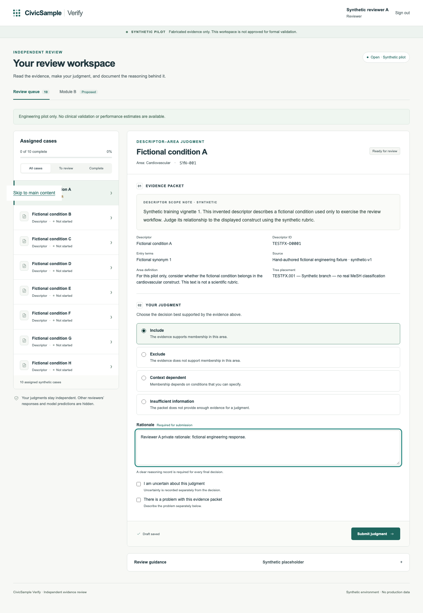
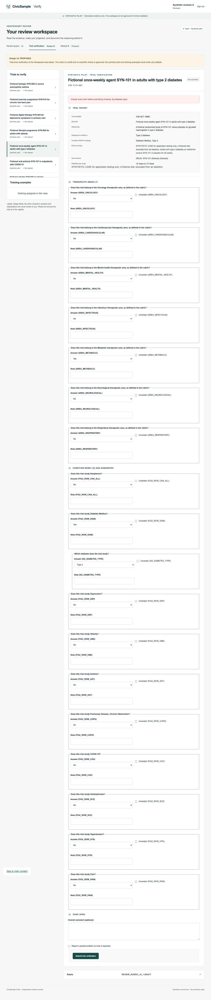

# CivicSample Verify

An investigator-operated synthetic pilot for blinded clinical classification review. Two independent reviewers assess the same fictional evidence, a separate adjudicator records the reference assessment, and the investigator locks and exports the audit record. **Formal clinical review and real study import remain disabled.**

## Start locally

Requires Node.js 22 or newer and npm. Run these commands in this repository:

```sh
npm ci
npm run setup -- --individual-credentials
npm run dev -- --port 3001
```

Open http://127.0.0.1:3001. Setup creates separate random passwords for `investigator`, `reviewer-a`, `reviewer-b`, and `adjudicator`. Read them privately in ignored `.local/pilot-access.txt`; do not copy that file into a message, issue, pull request, or commit. Existing settings and pilot records are preserved. Restart the server after changing credentials. Keep separate browser profiles for the four roles on the same computer.

Follow [the local pilot walkthrough](docs/LOCAL_PILOT.md) to review the ten fictional cases, test a custom evidence packet, submit independent responses, authorize adjudication, and export the locked pilot. Final judgments require deliberate submission and stay locked. The investigator's pilot JSON archive is excluded from clinical performance analysis.

Storage persists in ignored `.local/pglite`. Keep it intact when updating the application. Startup runs a read-only compatibility preflight before pending migrations 0008/0009 and again on subsequent starts. Incompatible frozen trial contracts or protected locked formal references require explicit investigator migration review; do not reset the database to bypass a refusal. See [implementation notes](docs/IMPLEMENTATION_NOTES.md) for the migration boundary.

## Verification

```sh
python3 -m venv .venv
.venv/bin/python -m pip install -r analysis/requirements.txt
VERIFY_ANALYSIS_PYTHON="$PWD/.venv/bin/python" npm run check
.venv/bin/python -m pytest -q analysis
npm run build
npx playwright install chromium
npm run test:e2e:production
npm run test:handoff
npm run test:postgres
```

The PostgreSQL suite needs a suitable test server and `VERIFY_PG_TEST_URL`; unavailable live checks report BLOCKED. Its CI job uses PostgreSQL 16. The browser suite uses a separate in-memory database. See [READINESS_REPORT.md](READINESS_REPORT.md) for the commands actually executed and their observed results. PGlite or native PostgreSQL success does not establish deployed Supabase JWT, MFA, or PostgREST security.

## Engineering boundaries

- [ARCHITECTURE.md](ARCHITECTURE.md): web/database/analysis boundaries and the handoff stack decision.
- [SECURITY_MODEL.md](SECURITY_MODEL.md): local authentication, database authorization, and blinding.
- [docs/SCIENTIFIC_CONTRACT.md](docs/SCIENTIFIC_CONTRACT.md): sanitized scientific invariants.
- [docs/APPROVAL_GATES.md](docs/APPROVAL_GATES.md): formal activation prerequisites.
- [docs/ANALYSIS.md](docs/ANALYSIS.md): the separate synthetic database-to-CSV-to-Python analysis path.
- [docs/DEPLOYMENT.md](docs/DEPLOYMENT.md): future staging and invited-team deployment plan.

This public repository must never contain private research handoffs, real cases or evidence, formal sample IDs, clinician identities, credentials, reviewer responses, or raw research extracts. Only generalized code, inspected documentation, and synthetic fixtures belong here. Historical migrations remain unchanged; new safeguards use additive changes.

## Current build scope

The local pilot supports independent review, adjudication, immutable export, and synthetic case authoring with a complete evidence preview. The separate synthetic v4 adapter reads database views and integrity RPCs, writes CSV, and feeds the Python validator and paired analysis. Its build SHA and ontology/rubric provenance must come from the actual export build and registered frozen case versions.

The production platform remains incomplete: verified invited Supabase authentication/MFA, formal campaign/import/freeze screens, multi-project management, and operational acceptance are outstanding. Local testing is the current phase. A forthcoming approval record must be received and checked before any scientific choice changes state; the software has not approved the Tier version, formal sample, rubric, adjudicator, or analysis plan.

This is a Next.js server application. GitHub Pages cannot host its authentication, APIs, or persistent database. A future approved deployment can use managed Next.js hosting plus Supabase; running the pilot does not authorize that deployment.





## Design v5: trial-level label verification

The proposed handoff v5 adds a separate trial-level verification module. Adoption of its scientific design is awaiting an explicit investigator approval record; it does not activate or replace the existing study automatically. The supplied migrations `0004_v5_trial_label_verification.sql` and `0005_v5_training_examples.sql` are committed byte-identical as `migrations/0011_...` and `migrations/0012_...` (renumbered only because this repository already holds additive migrations 0004 to 0010; SHA-256 values in [docs/HANDOFF_TESTS.md](docs/HANDOFF_TESTS.md)). The "Trial verification" tab gives every role its design v5 workspace: the reviewer form with 7 area items, 10 condition-row items and the two subgroup items shown only after the reviewer's own Yes, the training view, the adjudicator queue, and the investigator's gated actions (pilot import and assignment, lock, bundle export and registration, sign-off, activation, formal enrolment, freeze, phase events, snapshot). The supplied schema is followed by additive strict-boundary guards. The public application refuses formal activation, enrollment, imports, freeze and opening while protocol and hosted-identity acceptance are pending.

Two synthetic FORMAL-scope accounts, `staging-reviewer-1` and `staging-reviewer-2`, exist for training examples and synthetic formal dry runs; they are provisioned into an older persistent pilot only by an explicit investigator action. The bulk sample/prediction transfer files are not read by the web application. An optional private worked-answer file hook exists for assigned training examples; it has not been configured or approved for real material and still needs hash/protocol integration. The historical `npm run tlv5:staging-dryrun` implementation uses external hashed files and a disposable database; it is currently blocked pending protocol reconciliation ([docs/STAGING_PREFLIGHT.md](docs/STAGING_PREFLIGHT.md)). Bundle format 5.0 feeds `analysis/performance_analysis_v5.py`; the pilot bundle is analysed only with `--allow-pilot`. Design documents: [docs/design_v5/](docs/design_v5/). Acceptance: [docs/PILOT_ACCEPTANCE_CHECKLIST_v5.md](docs/PILOT_ACCEPTANCE_CHECKLIST_v5.md).

## Staging preparation

See [the staging preflight guide](docs/STAGING_PREFLIGHT.md) for external-file hash validation, the offline five-account plan, and native PostgreSQL checks. These tools do not create accounts or import records. The investigator's three shared examples will be calibration records excluded from formal outcomes; private training materials have been supplied but are not loaded into the persistent app. Tier 1 and v5 design adoption remain awaiting verified approval.

`npm run check` now includes the adapted upstream v4 and v5 leakage scans, also enforced by the pre-commit hook. `--tree` scans public source and indexed objects; ignored local runtime artifacts are excluded only while ignored. It is not a scan of the private study folder. All original content rules remain active. Python 3 and Node are required.

The upstream Python validation suite was executed unchanged from an isolated external copy; maintained application analysis tests live under `analysis/`, so run `.venv/bin/python -m pytest -q analysis` here. No private handoff files are needed to clone, run or test this repository.
