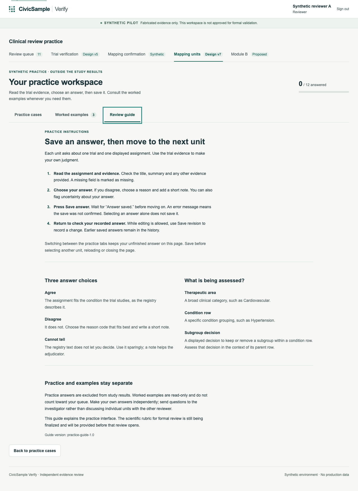
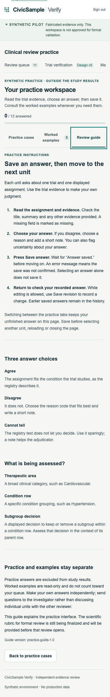

# Practice review guide — 2026-10-24

Scope: an operational guide for the existing synthetic v7 practice. This is not
the formal scientific rubric, a revised sample, or an approval record. No remote
database, deployment, invitation or study data was changed.

The Mapping units workspace now has three tabs: Practice cases (or the role's
workspace), Worked examples, and Review guide. Switching tabs keeps the existing
panels mounted and does not submit an answer. The optional guide does not change
the older mapping-confirmation workspace's two-tab interface.

The guide explains saving before leaving a unit, revisions and history, answer
choices, and the difference between area, condition-row and subgroup decisions.
It reuses the existing answer wording. The packet header identifies the mapping
family already present in the permitted packet; no additional data is fetched.
Investigators and adjudicators receive an explicit explanation of their role.

## Observed checks

- `VERIFY_ANALYSIS_PYTHON=/path/to/venv/bin/python npm run check`: 231 Node tests
  passed, 30 skipped (native PostgreSQL/live staging unavailable), 1 existing
  proposal to-do. Typecheck and lint passed; fixture/leakage checks are included.
- `npm run test:handoff`: PASS with the pre-existing documented schema-version
  and stricter-adjudicator exceptions (current v7 chain: 360/362).
- `npm run build`: PASS, 33 SQL inputs in the production trace allowlist.
- `npm run test:e2e:production`: PASS, 9 served-browser scenarios. The v7 test
  checks three-tab keyboard wrapping, Home/End, no submission during tab changes,
  unchanged unsaved input, subsequent save/reload/revision, role isolation,
  adjudication and export. Its database and accounts are synthetic and disposable.
- Axe WCAG 2 A/AA checks on the guide at desktop and 390px: no violations.
- Reflow: no page overflow at 320, 390 or 640px; guide tab touch height at least
  44px. Desktop and mobile screenshots were visually inspected.
- Changed UI/test files pass Prettier; `git diff --check` passes. Repository-wide
  `npm run format:check` retains 15 baseline warnings in supplied fixtures,
  harnesses and design documents. These were not reformatted.
- A full screen-reader audit, browser-level 200% zoom and live Supabase testing
  were not performed. Automated checks are not a complete accessibility audit.

## Next scientific integration boundary

The investigator has chosen 100 mappings per reviewer, distributed across all ten
areas as well as the condition-row and subgroup portions of the assessment.
The revised allocation and scientific package are awaited. This guide does not
choose their contents. In particular, migration 0024's `mu7_category_ok` and
`mu7_area_label` still enumerate the original seven areas. The new package will
need a reviewed additive migration, packet/display validation, updated rubric
provenance, sampling/export checks and synthetic coverage for the additional
areas. Historical migrations and operational practice responses must survive
that upgrade. Formal review remains disabled.
